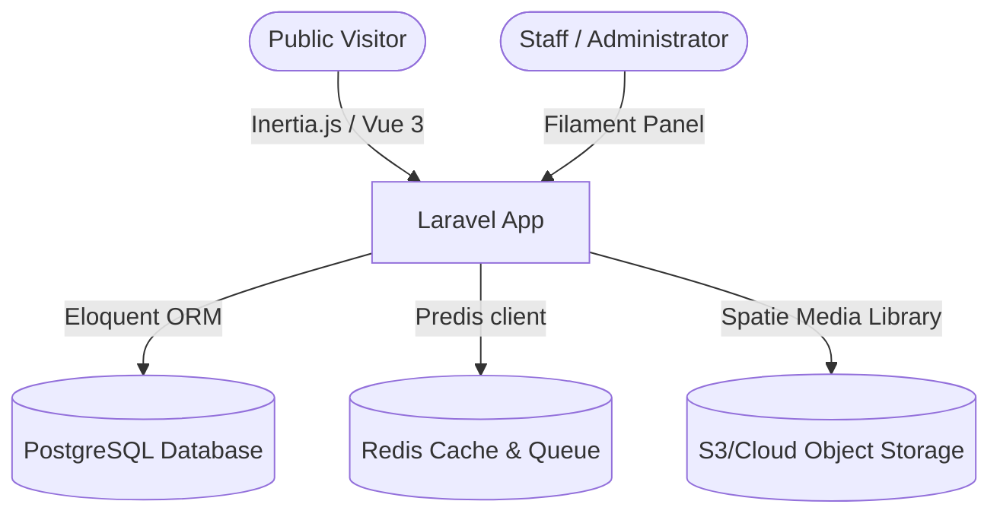

# System Architecture - Speaker Achievement Portal

This document outlines the architectural patterns and design decisions of the official public information and achievement portal for the Office of the Speaker of the House of Representatives, Federal Republic of Nigeria.

## Core Architecture Pattern
The system is built as a single, consolidated Laravel monolithic application.

### Key Architectural Guidelines
1. **Direct Inertia Rendering**: Public pages are served directly via Laravel Inertia controller responses to Vue 3 views. We avoid exposing public REST APIs to reduce attack vectors and network overhead.
2. **Dedicated Admin Panel**: The backend administration is managed via Filament (Laravel + Livewire), restricted to authenticated personnel with proper roles.
3. **Queue-First Operations**: Media processing, newsletter dispatch, and activity logs are offloaded to Redis queues to keep page loads fast.
4. **Media Handling**: All file attachment storage, conversion, and organization uses Spatie Laravel Media Library.
