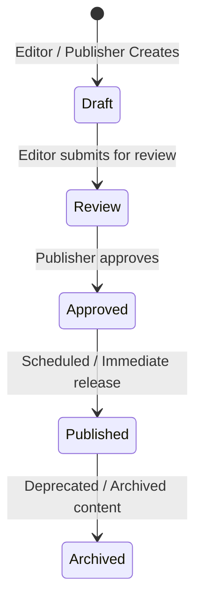

# Content Management Workflow

This document explains the content moderation lifecycle and guidelines for publishing records on the Speaker Achievement Portal.

## 1. Content Workflow States

### Workflow Rules
- **Draft**: Initial state. Visible only to editors and authors. No public visibility.
- **Review**: Content is finalized by the Editor and flagged for administrative inspection.
- **Approved**: Verified by a Publisher but not yet live.
- **Published**: Publicly visible on the frontend web portal.
- **Archived**: Hidden from index pages, but accessible via permalink or internal records (read-only).

## 2. Roles & Workflow Permissions

- **Editors** can create content and transition records from `draft` to `review`.
- **Publishers** can change statuses to `approved` and `published`.
- **Super Admins** can manage site settings and oversee all workflow transactions.
